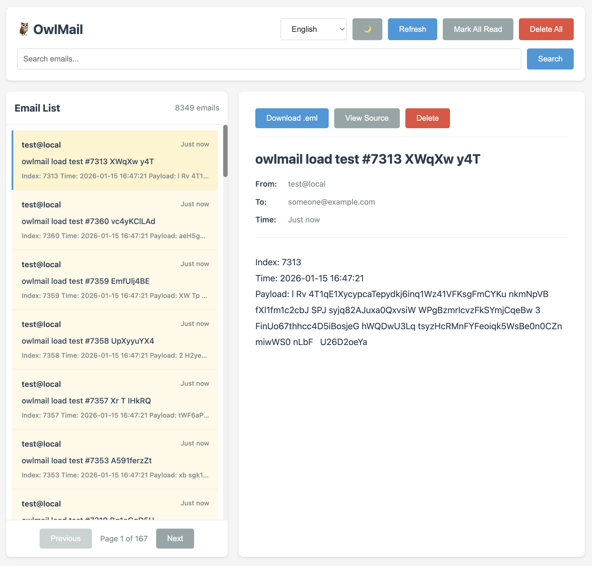
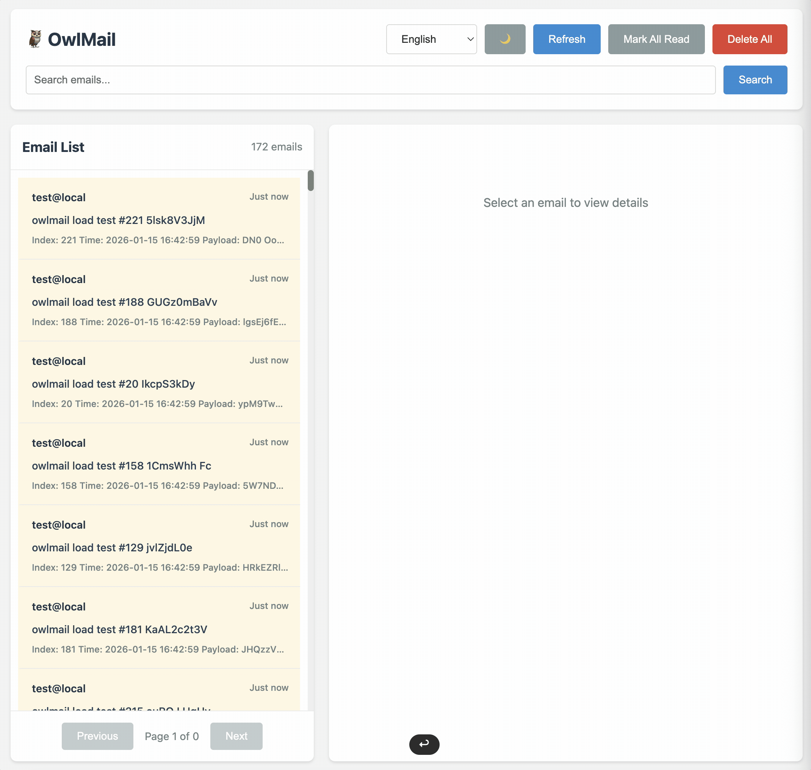

# OwlMail

Capture application email locally, inspect its content and attachments, and verify delivery in CI and coding-agent workflows.

[](.github/go-test-report.md) [](.github/goreportcard-report.md) [](https://github.com/soulteary/owlmail/releases) [](LICENSE)

[English](README.md) · [简体中文](README.zh-CN.md) · [Deutsch](README.de.md) · [Français](README.fr.md) · [Italiano](README.it.md) · [日本語](README.ja.md) · [한국어](README.ko.md)

Point your application's SMTP settings at OwlMail to capture signup, password-reset, and notification emails. Inspect them in the browser, or let tests and coding agents read the same committed messages through REST, WebSocket, or read-only MCP.

OwlMail runs as a single Go executable with an embedded Web UI. Docker images support Linux amd64 and arm64. The executable needs no Go, Node.js, or Bun runtime.


## 📸 Preview



## 🎥 Demo Video



## Why OwlMail

- **Inspect mail and check expectations.** View HTML, text, headers, source, and attachments. Verify subject, body, and link hosts in the browser; use the API for attachment count, filename, type, size, and SHA-256 assertions.
- **Bring asynchronous email into your tests.** Capture a delivery cursor, trigger your application, wait for a specific test run's messages, and clean up only that run.
- **Give agents a read-only inbox.** MCP provides search, retrieval, and bounded delivery waits. OwlMail itself requires no LLM.
- **Understand downstream delivery.** Use Webhooks or manual and automatic SMTP Relay. The UI shows delivery outcomes, attempts, and failure categories.
- **Add operations features when you need them.** Local EML persistence, recovery, and quarantine; optional SQLite indexing, S3 attachment storage, Redis Streams, and Prometheus metrics.

## Choose a version

The Docker quick start below uses stable **0.11.1** for SMTP capture, browser verification, cursor-based tests, read-only MCP, and delivery diagnostics.

All workflows below are available in **0.11.1**. Pin a release or image digest for repeatable CI; `main` and `latest` are moving development tags. See [0.11.1 release notes](docs/en/Release-0.11.1.md) and [the previous 0.10.1 release](docs/en/Release-0.10.1.md).

## Quick start: receive your first email

### 1. Start OwlMail

```bash
docker run -d --name owlmail \
  -p 127.0.0.1:1025:1025 \
  -p 127.0.0.1:1080:1080 \
  -v owlmail-data:/app/mail \
  ghcr.io/soulteary/owlmail:0.11.1

curl --fail --silent --retry 10 --retry-connrefused --retry-delay 1 \
  --max-time 2 --output /dev/null http://127.0.0.1:1080/readyz
```

Open [http://localhost:1080](http://localhost:1080). Messages are stored in the `owlmail-data` volume; keep mounting it when you recreate the container.

The ports are published only on your machine. SMTP uses NO AUTH by default. For team access, use a private network and configure Web authentication and HTTPS.

### 2. Configure your application's SMTP

For an application running on your machine:

```text
SMTP host: 127.0.0.1
SMTP port: 1025
TLS: off
Authentication: none
```

For an application on the same Compose network, use the OwlMail service name, such as `owlmail`, and port **1025**. Inside a container, `localhost` refers to that container itself.

You can also send a first message with curl:

```bash
curl --url smtp://127.0.0.1:1025 \
  --mail-from sender@example.test \
  --mail-rcpt developer@example.test \
  --upload-file - <<'MAIL'
From: sender@example.test
To: developer@example.test
Subject: Hello OwlMail
Content-Type: text/plain; charset=utf-8

Your test code is 123456.
MAIL
```

### 3. Inspect the captured message

Open the message in the browser, inspect its body and attachments, or query REST:

```bash
curl --fail http://127.0.0.1:1080/api/v1/emails
```

Dark mode and preview width controls are available in the inbox. Lists return paginated results. Reading a native `/api/v1` message does not mark it as read. See the [API reference](docs/en/API-Reference.md) and the running server's [OpenAPI JSON](http://localhost:1080/api/v1/openapi.json) / [YAML](http://localhost:1080/api/v1/openapi.yaml). The [checked-in YAML contract](openapi/openapi.yaml) is available without running a server.

## Inspect and verify in the browser

- Switch between HTML, text, headers, and source; inspect attachments and inline images.
- Check phone, tablet, and desktop layouts at seven preview widths without resetting the preview's scroll position.
- Use dark mode, search, structured filters, batch read/delete, and ZIP exports.
- Open the command palette with `Ctrl/Cmd + K` or `?`; navigate with `j/k` or `↑/↓`, search with `/`, and refresh with `r`.
- Set subject, body, and link-host expectations in **Verify**. Manually refresh **Deliveries** to inspect Relay / Webhook outcomes and confirm retries.

Subject and body assertions are case-sensitive substring checks. Link checks inspect URLs in the stored message without fetching them. Six-digit extraction returns candidates, not proof of a valid verification code. New Verify / Deliveries controls may use English locale fallback.

HTML previews use an isolated iframe. Remote images, fonts, and styles are blocked by default and can be loaded explicitly for the selected message.

## Wait, check, and clean up in CI

This example uses only the Python 3 standard library. Save it as `email-check.py` and run `python3 email-check.py` after starting the stable instance above:

```python
import json
import smtplib
import uuid
from email.message import EmailMessage
from urllib.request import ProxyHandler, Request, build_opener

API = "http://127.0.0.1:1080"
HTTP = build_opener(ProxyHandler({}))
RUN_ID = "readme-" + uuid.uuid4().hex
RECIPIENT = "signup+" + RUN_ID + "@example.test"


def api(method, path, body=None):
    data = None if body is None else json.dumps(body).encode()
    request = Request(
        API + path,
        data=data,
        method=method,
        headers={"Content-Type": "application/json"},
    )
    with HTTP.open(request, timeout=35) as response:
        return json.load(response)


cursor = api("GET", "/api/v1/emails/cursor")["cursor"]

message = EmailMessage()
message["From"] = "sender@example.test"
message["To"] = RECIPIENT
message["Subject"] = "Verify your account"
message["X-OwlMail-Run-ID"] = RUN_ID
message.set_content("Your test code is 123456.")
with smtplib.SMTP("127.0.0.1", 1025, timeout=10) as smtp:
    smtp.send_message(message)

result = api("POST", "/api/v1/emails/wait", {
    "after": cursor,
    "run_id": RUN_ID,
    "recipient": RECIPIENT,
    "count": 1,
    "timeout_seconds": 10,
})
if result["timed_out"] or not result["emails"]:
    raise RuntimeError("Expected email did not arrive")

email_id = result["emails"][0]["id"]
report = api("POST", "/api/v1/emails/" + email_id + "/check", {
    "subject_contains": ["Verify your account"],
    "text_contains": ["123456"],
    "attachment_count": 0,
})
if not report["passed"]:
    raise RuntimeError(json.dumps(report["checks"]))

cleanup = api("DELETE", "/api/v1/test-runs/" + RUN_ID + "/emails")
if cleanup["failed"] or cleanup["more_possible"]:
    raise RuntimeError("Test-run cleanup is incomplete")
print("PASS: received, checked, and cleaned up", RUN_ID)
```

For a real application test, replace `smtp.send_message` with the signup, password-reset, or other business action, and add `X-OwlMail-Run-ID` to its outgoing mail. Keep the cursor → trigger → wait order to include mail that arrives before the wait starts.

The example cleans up after a passing assertion and leaves failed-test mail available for diagnosis. `run_id` groups tests; it is not tenant isolation or authorization. Cursors are scoped to the running process. A timeout returns `timed_out: true`, which your test must check independently of HTTP status. Wait `count` is an at-least threshold.

See [delivery waits and test runs](docs/en/Delivery-Waits-and-Test-Runs.md), [JavaScript / Go / Python examples](examples/testing), and the [CI quick start](docs/en/CI-Quickstart.md).

## Let a coding agent inspect mail

MCP is disabled by default. This is a standalone binary deployment. First prepare `./owlmail` using [the binary instructions](#run-the-binary) and make sure host ports 1025 / 1080 are free. Set a nonempty `OWLMAIL_WEB_PASSWORD` before starting the HTTP endpoint:

```bash
./owlmail -mcp-enabled \
  -web-user agent \
  -web-password "$OWLMAIL_WEB_PASSWORD"
```

Connect a Streamable HTTP client to `http://127.0.0.1:1080/mcp` with those Basic Auth credentials. For Docker, recreate the container with `-e OWLMAIL_MCP_ENABLED=true` and the corresponding Web credentials.

A local client can instead use stdio to read an existing mail directory:

```json
{
  "mcpServers": {
    "owlmail": {
      "command": "/absolute/path/to/owlmail",
      "args": ["mcp-stdio", "-mail-directory", "/absolute/path/to/mail"]
    }
  }
}
```

The seven MCP tools list, search, retrieve details, read raw source, list attachment metadata, retrieve recent mail, and wait for delivery. HTTP reads the running mailbox directly; stdio reads committed EML files and periodically scans the directory.

An agent can report whether signup mail arrived, extract a link from the message body, and return a browser URL as evidence. MCP exposes no deletion, Relay, or configuration tools. Raw MIME may contain attachment payloads, but there is no dedicated decoded-attachment download tool. Pass the cursor returned by list/search to `wait_for_email`; see the [MCP reference](docs/en/MCP-Reference.md) and [test-run contract](docs/en/Delivery-Waits-and-Test-Runs.md).

## Send mail events to automation or relay to a real inbox

### Webhooks

The embedded `/webhooks` page generates, imports, and downloads configuration. It does not modify the running server. Save the file and start or restart OwlMail with `-webhook-config`.

For a local receiver, have it listen on port `18080`, then save this as `webhooks.json`:

```json
{
  "version": 1,
  "targets": [
    {
      "name": "local-receiver",
      "url": "http://127.0.0.1:18080/owlmail"
    }
  ]
}
```

```bash
./owlmail -mail-directory ./mail -webhook-config ./webhooks.json
```

This is a standalone host-binary example; install the binary and ensure its default listener ports are free first. Container `127.0.0.1` refers to the OwlMail container itself; use the receiver's service name on a shared network and mount the configuration file for container deployments.

Webhooks support recipient/subject filters, custom bodies, HMAC signatures, and retries. For restart-safe queued delivery, use a persistent mail directory, persisted Redis Streams, and receiver deduplication by `X-OwlMail-Delivery-ID`. Without Redis, local outbox persistence covers handoff only; events accepted by the in-memory queue do not survive every restart boundary.

See the [Webhook guide](docs/en/Webhook-Forwarding.md) and [runnable Compose example](examples/webhooks/soulteary-webhook).

### SMTP Relay

Configure an outgoing SMTP server to relay selected messages manually or forward automatically under filtering rules. Transport modes are `plain`, mandatory `starttls`, and `smtps`; certificate verification is enabled by default.

The native Relay API accepts an asynchronous job. Follow its status to determine the outcome. A persistent mail directory retains jobs and recovers unfinished work. Recovery can duplicate a delivery, and a successful send does not prove final placement in the recipient's inbox.

Configure recipients and TLS policy before enabling forwarding. See [Relay and operations settings](docs/en/Operations.md).

## Installation and everyday configuration

### Run the binary

Download a platform binary from [Releases](https://github.com/soulteary/owlmail/releases), rename it to `owlmail`, and run `chmod +x owlmail` on Unix platforms. In this README, `./owlmail` means that downloaded or locally built file.

Alternatively, install stable with Go 1.27.3+:

```bash
go install github.com/soulteary/owlmail/cmd/owlmail@v0.11.1
owlmail -mail-directory ./mail
```

For `go install`, use `owlmail` instead of `./owlmail` in the examples and ensure the Go installation directory is on `PATH`.

The host binary listens on `localhost` by default. Specify `-mail-directory` for a persistent mailbox.

Build the current main branch:

```bash
git clone --branch main --depth 1 https://github.com/soulteary/owlmail.git
cd owlmail
go build -o owlmail ./cmd/owlmail
./owlmail -mail-directory ./mail
```

### Use a configuration file

Flat YAML and JSON use CLI option names as keys. Save this as `owlmail.yaml`:

```yaml
smtp: 1025
web: 1080
mail-directory: ./mail
mail-retention-days: 7
smtp-max-concurrency: 8
log-format: json
```

```bash
./owlmail -config ./owlmail.yaml
```

This stores mail locally and applies a seven-day retention policy. Add `mail-max-messages` or `mail-max-disk-mb` for capacity limits. Environment variables and CLI flags can override the file. See the [configuration reference](docs/en/Configuration-Reference.md) for every flag, default, and environment alias, and [operations](docs/en/Operations.md) for deployment profiles.

### Diagnose and probe the service

```bash
./owlmail doctor -config ./owlmail.yaml
./owlmail healthcheck -config ./owlmail.yaml
./owlmail healthcheck --ready -config ./owlmail.yaml
```

`doctor` checks configuration and recovery records offline; it does not connect to downstream services or prove runtime availability. `healthcheck` probes the running service, and `--ready` checks cached runtime readiness. The container probe uses the startup configuration snapshot, so you do not need to repeat port and HTTPS settings in its command.

For SMTP-only operation, use `-disable-web`; it serves no Web UI, REST, or HTTP MCP. Standalone SMTP-only readiness requires an explicit absolute mail directory. See [operations](docs/en/Operations.md).

## Migrate from MailDev or MailCatcher

SMTP-only applications usually need a new host and port. Existing REST clients can opt into the default-off facades:

```bash
./owlmail -maildev-rest-compat
# or
./owlmail -mailcatcher-rest-compat
```

Facades cover the documented HTTP workflows, not MailDev's Node embedding API, Socket.IO, or MCP tool contract. Use native `/api/v1` and standard WebSocket for new integrations.

See the [MailDev / MailCatcher / Mailpit comparison and migration guide](docs/en/Comparison-and-Migration.md).

## Scope and deployment boundaries

OwlMail is for development, CI, and trusted test networks. It stores full mail, which may contain verification codes, reset links, and test credentials. Host listeners default to loopback; team deployments need fixed credentials, HTTPS, and network access controls.

- One writable OwlMail instance owns a mail directory. Shared multi-writer mailboxes and tenant authorization are not supported.
- S3 stores decoded attachments only. EML, metadata, and delivery state still require local persistence.
- Webhooks and recovered Relay jobs may repeat; downstream receivers need idempotent handling.
- OwlMail does not provide a production MTA, IMAP / POP3, spam scoring, or certification of rendering in real mail clients.

See the [security model](docs/en/Security-Model.md).

## Documentation and feedback

- [0.11.1 release notes](docs/en/Release-0.11.1.md) · [Previous 0.10.1 release notes](docs/en/Release-0.10.1.md)
- [Integration testing](docs/en/Integration-Testing.md) · [Sendmail-compatible CLI](docs/en/Sendmail.md)
- [Configuration reference](docs/en/Configuration-Reference.md)
- [API and OpenAPI](docs/en/API-Reference.md)
- [Agent integration](docs/en/AI-Agent-Testing.md)
- [Deployment, persistence, TLS, and metrics](docs/en/Operations.md)
- [Architecture](docs/en/Architecture.md) · [Changelog](CHANGELOG.md)
- [Contributing](.github/CONTRIBUTING.md) · [Issues](https://github.com/soulteary/owlmail/issues)

Include your version or commit, startup method, redacted configuration, error output, and a minimal reproduction when reporting a problem. Use the [security reporting channel](.github/SECURITY.md) for vulnerabilities.

## License and acknowledgments

[MIT](LICENSE). Inspired by [MailDev](https://github.com/maildev/maildev), and built on upstream Go SMTP / MIME, Fiber, and WebSocket projects.
